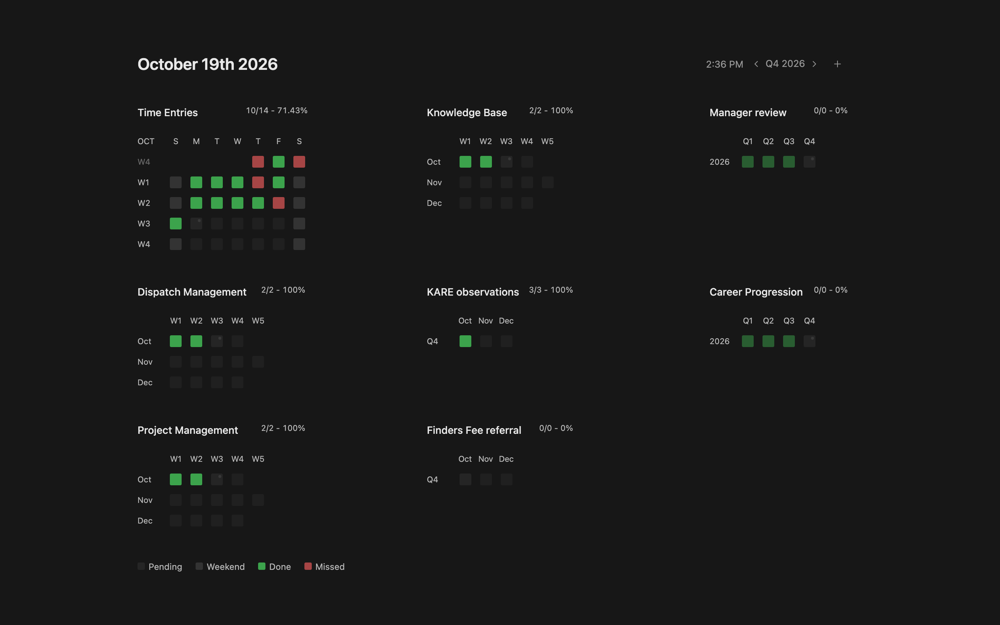
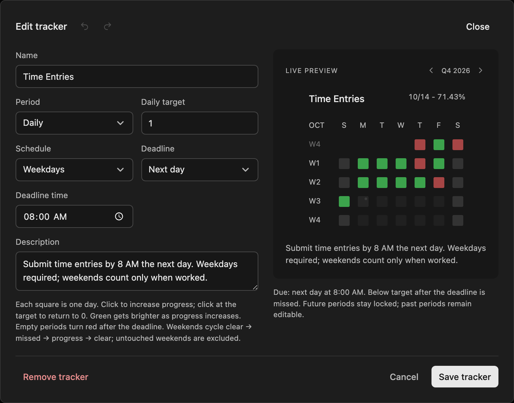
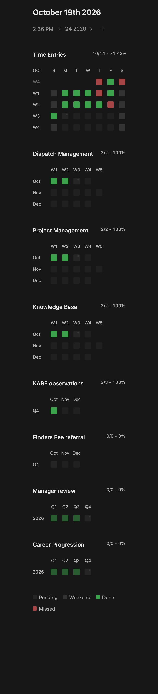

# Keplio

Keplio tracks recurring KPIs by day, week, month, or quarter. Each square represents one period, and its color shows progress toward the target. The screenshots show an example setup. New copies start empty.



## Getting started

**Download ZIP**, extract the folder, and open **index.html** in your browser. Keep the files together. There is nothing to install, and the app can also run from a static web host.

Click **+** to add a tracker. Give it a name, choose its period, and set a target from 1 to 30. Daily trackers can use a weekday or everyday schedule. The description is a place to explain what counts toward the target, and deadlines are optional.

## Recording and editing progress

Click a square to add one completion. For a target of three, successive clicks record one, two, then three completions; clicking again resets it to zero. Green becomes brighter as the count approaches the target. Future periods are locked, but you can update past entries.

Click a tracker title to open the editor. Its live preview lets you try the settings and record progress before saving. Undo and redo apply to the draft, **Save tracker** keeps the changes, and **Cancel** discards them. Changing the period replaces that tracker's entries after confirmation. **Remove tracker** deletes the tracker and its recorded progress after a separate confirmation.

To rearrange the page, drag a tracker's title over another tracker. The two cards swap positions while you drag; release to save the order or press **Escape** to restore it. The layout wraps into fewer columns on smaller screens.



## Deadlines and scoring

A tracker can have no deadline, a deadline at the end of each period, or—in the case of daily trackers—a custom time the following day. Dates and deadlines currently use **America/Boise** time.

The score beside a title covers the selected quarter and gives credit for recorded progress. Unfinished work only counts against it once its deadline passes. For example, one completion toward a target of three shows **1/1 - 100%** before the deadline. If the deadline passes without further progress, it becomes **1/3 - 33.33%**. The square's shade still reflects one out of three in both cases, so a 100% score does not mean every target for the quarter is finished.

With no deadline, the numerator and denominator stay equal: five recorded completions show **5/5 - 100%**. A tracker with nothing recorded or due shows **0/0 - 0%**. Future periods and untouched optional weekends are excluded, and credit for each period is capped at its target.

## Reading the calendar

Dark squares have nothing recorded or represent future periods. Green indicates partial or full progress, while red indicates an overdue period with no progress or a weekend explicitly marked missed. Partial progress stays green after its deadline. Hover over a square for the exact count and status; the same information is available to screen readers.

On a weekday schedule, untouched weekends are gray and do not affect the score. With deadlines enabled, clicking an optional weekend cycles through missed, progress, and clear. Without a deadline, it cycles through progress and clear.

Use the header arrows to change quarters. Daily calendars show one month at a time, with month arrows that appear on hover or remain visible on touch devices. The daily score still includes all three months. Refreshing returns to the current quarter.

Weeks start on Sunday and belong to the month in which they start. A week carried over from the previous month has a dimmed label. Monthly trackers show the three months of the selected quarter; quarterly trackers show Q1–Q4 of the selected year, with earlier quarters dimmed. Small dots mark today, the current week, or the selected quarter.

<details>
<summary>Phone layout</summary>



</details>

## Saved data

Data is saved in your browser, not in this repository or a shared database. It does not sync between coworkers, devices, or browser profiles. Return using the same browser profile and file location to keep using your saved trackers. Clearing browser data removes them, private browsing may not retain them, and moving the folder can change where the browser looks for them.

If a save fails, the app restores the previous state. If another tab has changed the saved data, it asks you to reload rather than overwrite those changes.

## Current scope and development

The app records whole-number completion counts. It does not currently calculate measured KPIs such as revenue, survey percentages, lower-is-better metrics, or weighted averages. The percentage beside each title is the completion score described above.

The source is plain HTML, CSS, and JavaScript, with rendering, scoring, and storage separated under [`src/`](src/). There is no server-side backend or runtime dependency. To run the development checks with Node.js 22 or newer:

```sh
node scripts/check.cjs
```

The [development guide](docs/development.md) covers the source layout, browser checks, screenshots, and custom storage adapters.
