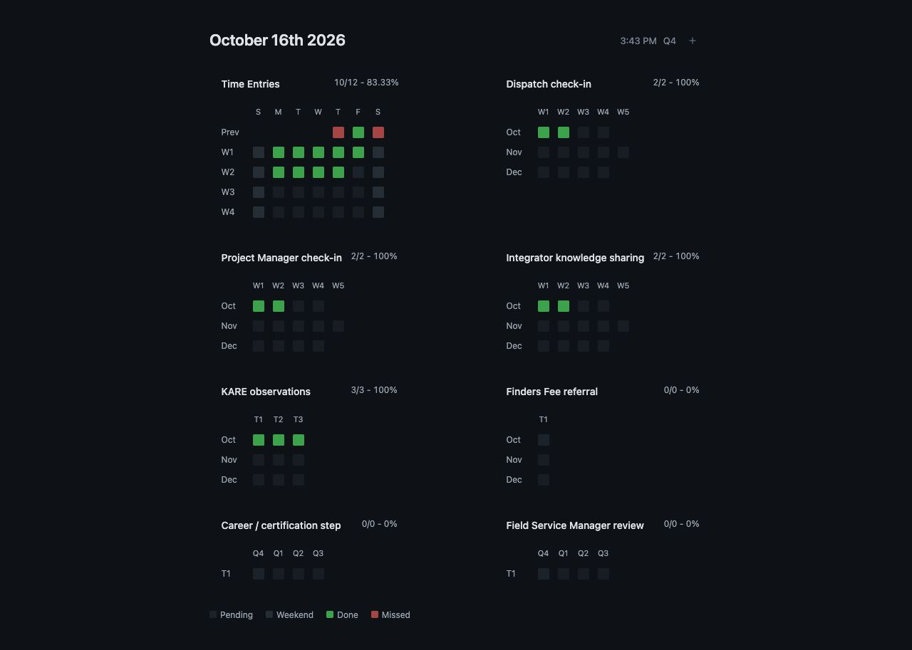
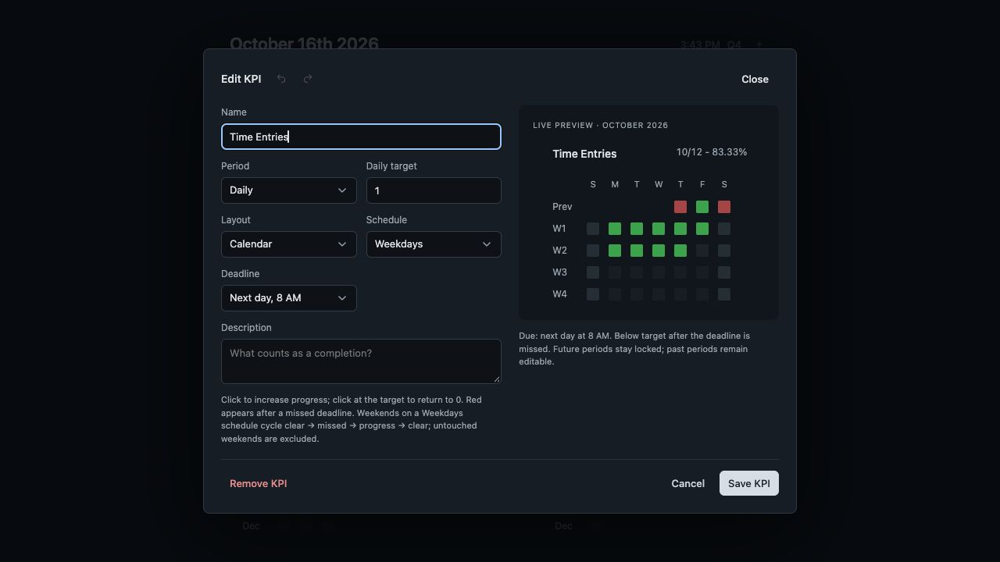

# Keplio

A lightweight KPI tracker for daily habits, weekly check-ins, and monthly or quarterly goals. Set targets, record progress, and see what is complete or overdue at a glance.

Built with plain HTML, CSS, and JavaScript. Open it in your browser or integrate it into your own app—no dependencies or build step required.



## Get started

1. Choose **Code → Download ZIP** on this GitHub repository.
2. Extract the ZIP and open `index.html` in a modern browser.
3. Click **+** beside the quarter to add your first KPI.

Keplio starts empty. The screenshots show an example setup you can use for inspiration.

Keep the extracted files together so the page can load its styles and scripts. You can also serve the application from a static web host.

## Create and manage KPIs

Give each KPI a name, choose a daily, weekly, monthly, or quarterly period, and set its target. Daily KPIs also let you choose a calendar or target-row layout, a weekday or everyday schedule, and a deadline.

The editor includes an interactive preview: click its squares to try the setup before saving. Undo and redo apply to the current draft. **Save KPI** applies your changes; **Cancel** discards them.

- **Edit:** click a KPI title.
- **Reorder:** drag a title, or focus it and use **Alt + arrow keys**.
- **Delete:** choose **Remove KPI**, then confirm. This deletes the KPI and its recorded progress.

Changing a KPI’s period or layout replaces its existing entries when you save. Keplio asks you to confirm this first.



## Record progress

Click a square to record a completion. Daily calendars and weekly grids count up to the target; clicking again at the target resets the square. Daily target rows, monthly goals, and quarterly goals use a separate square for each completion.

| Status | Meaning |
| --- | --- |
| Pending | The deadline has not passed and the target is not yet complete. |
| Weekend | An untouched weekend on a weekday schedule; excluded from the score. |
| Done | The target has been met. |
| Missed | The deadline passed before the target was met, or an optional weekend was marked missed. |

On a weekday schedule, clicking a weekend cycles through missed, progress, and clear. Future periods are locked; past entries remain editable.

The score beside each title shows completed squares out of completed and overdue squares, followed by the completion percentage. Pending squares and untouched optional weekends do not count against the score.

### Dates and deadlines

- Dates and deadlines use **America/Boise** time.
- Weeks run **Sunday–Saturday** and belong to the month in which they start.
- Daily calendars show the current month. Weekly and monthly tables show the current quarter.
- Quarterly tables follow an **October–September** cycle.
- Daily deadlines can be the end of the day or **8 AM the next morning**. Other periods are due at the end of the period.

## Your saved data

Keplio saves your KPIs and progress automatically in the browser you use. Return using the same browser profile and location to continue where you left off. Data does not sync between browsers or devices.

Clearing the browser’s website data removes your saved tracker. Private browsing may not retain it after the session ends. When opening `index.html` directly, storage behavior depends on the browser; moving the folder can make previously saved data unavailable. For a consistent location, serve Keplio from a fixed web address.

If a save fails, Keplio displays an error and restores the previous state. If another tab has changed the tracker, reload before continuing.

## Integrate into your app

The application consists of five files:

| File | Purpose |
| --- | --- |
| `index.html` | Interface markup and script loading |
| `styles.css` | Appearance and responsive layout |
| `app.js` | Rendering, editing, previews, and dragging |
| `rules.js` | Dates, deadlines, and scoring |
| `storage.js` | Data validation and persistence |

Serve these files together, embed the page in an iframe, or adapt the markup to your host application. When embedding the markup directly, preserve the `#kpi-concept` container and adjust the `body` rule in `styles.css` to suit your page. Keep the script order: `rules.js`, `storage.js`, then `app.js`.

### Connect your storage

By default, `storage.js` uses the browser’s `localStorage` under the key `keplio.v1`. To store data through your own application, define `window.KeplioStorage` before `storage.js` loads:

```js
window.KeplioStorage = {
  async load() {
    return await yourApp.readTracker();
  },
  async save(data) {
    await yourApp.writeTracker(data);
  },
};
```

Replace `yourApp.readTracker()` and `yourApp.writeTracker()` with your own storage functions. Both methods may return values synchronously or use promises.

- **`load()`** returns `{ version: 1, items: [] }` for a new tracker, or a saved document in the same format.
- **`save(data)`** receives the complete document, including KPI order and progress. Resolve only after saving succeeds; throw an error on failure.

Keplio validates documents and passes copies to and from the adapter. A failed save rolls back the visible change. Your adapter is responsible for handling concurrent updates and ensuring that writes succeed together.

Each KPI contains `id`, `name`, `period`, `layout`, `target`, `schedule`, `deadline`, `description`, and `marks`. See [`storage.js`](storage.js) for the schema and validation limits, and [`rules.js`](rules.js) for entry keys and scoring behavior.

The default browser adapter checks for stale data before saving and uses Web Locks to serialize writes across tabs when supported. Without Web Locks, concurrent-write protection is best effort.

## Development checks

Use Node.js 22 to run the checks below. Node.js is only needed for development; the application runs in the browser.

```sh
node tests/rules.cjs
node tests/storage.cjs
node tests/release.cjs
node --check app.js
```

These checks cover scoring rules, storage validation and conflicts, application files, and JavaScript syntax. GitHub Actions runs them on pushes and pull requests.
